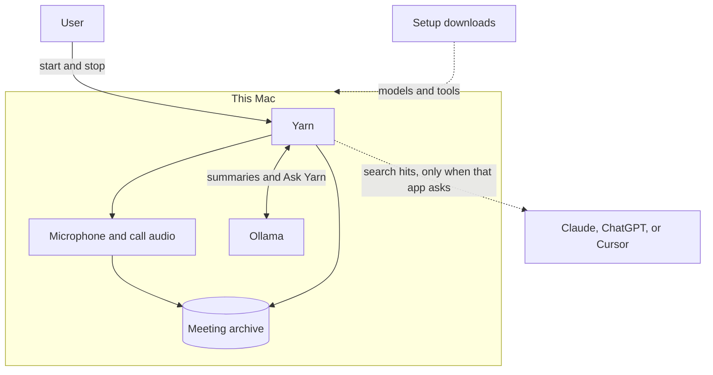

# Yarn — high-level architecture

Yarn records a meeting when a person starts it, transcribes and names speakers on that Mac, and keeps the transcript as the record. Search, summaries, and Ask Yarn use local models. A connected chat app can search the same index. That is the one path that sends meeting text off the Mac, and only the passages that app retrieves.

Diagram source: [diagrams/system-context.mmd](diagrams/system-context.mmd).

## What each part does

| Part | Role |
|---|---|
| User | Starts and stops a recording. Confirms who a voice was. |
| Yarn.app and the menu bar | The controls. Recording does not start because a calendar event or a voice detector fired. |
| Microphone capture | `ma-capture`, a LaunchAgent, records the mic through CoreAudio. |
| Call audio | For a headphone call, Yarn.app records the mix of audio the Mac is playing. A room recording does not do this. |
| Meeting archive | Audio, transcripts, notes, speaker clips, and the search index. Default location is `~/meeting-archive`. |
| Watcher | `ma watch` turns a finished recording into a transcript and a search index. |
| Ollama | Writes summaries, daily briefs, and Ask Yarn answers on `127.0.0.1:11434`. |
| Chroma | Derived search index. Rebuildable from the transcripts with `ma rebuild`. |
| Setup downloads | Whisper, speaker models, and Ollama the first time. Meeting content is not part of those downloads. |
| Connected chat app | Optional. Setup can install a local search server for Claude. The app receives a passage when it searches. |

## What we tell people

Nothing joins the call. Yarn records the Mac, so it works with whatever meeting app is already open.

Who spoke is part of Yarn. A live transcript is not. The record is the meeting after it ends. Watching words appear while people are still talking is a different product, and it is the wrong one unless the point is live translation.

Yarn Setup and Yarn are signed with a Developer ID, so a downloaded zip opens without a Gatekeeper warning. The first room recording still asks for the microphone. The first headphone call still needs Yarn added with + under Screen & System Audio Recording, chosen from the Applications folder in the home folder. macOS does not show an Allow button for that row. The signing steps are in [docs/signing.md](../signing.md).

## Who said what

Yarn separates voices, then recommends a name. It does not invent one.

1. The microphone on a call is the owner. The room channel is not, even when the same laptop is in the room.
2. On a call, everyone else is in what the Mac is playing. On a headphone call where the first pass returns one voice, Yarn looks again at a tighter cut so two people are not left glued together. A listed head count is not forced onto the audio. It is only a reason to look again when the first pass found fewer people than were named.
3. A fragment under ten seconds is folded into the longer voice it sounds like. With no fingerprint, it goes to the voice beside it. A measured different person stays, however short. A clip under a second is dropped as its own speaker. The words stay.
4. The identify box is filled in only when the recommendation is clear. If the meeting already lists who was there, the name has to be one of those people, the voice match has to be overwhelming, and it has to lead the next person in the room and anyone who was not there. A strong match to someone who was not in the meeting stays blank. A near tie between two people who were stays blank. With no list, a strong saved-voice match is still offered. Saying the name in the conversation can fill the box when that name is already on the list. The person still confirms it.
5. The only name written without that confirmation is the last one left. One unnamed voice, one unused name on a list the person already typed, and every other listed name already assigned. Yarn writes it and marks it assumed. An empty list assumes nothing. On a call, the owner’s own name is not spent on a remote voice.

## Two ways to record

**Room** is the default. One microphone, several people. The channel is `room`. Nobody is labelled as the owner just because the laptop was in the room. Diarisation may split the audio into Speaker 1, Speaker 2, and so on. Otherwise the label stays Unknown.

**Call** is a video call with headphones. The microphone channel is `mic` and is the owner. Everyone else is `sys`, taken from what the Mac is playing. Diarisation may split `sys` into separate speakers. A recommended name is filled in under the rules above. It is stored when the person confirms it, or when it is the last name left on their list.

## From stop to searchable notes

Audio is on disk before any dialog appears. Dismissing the dialog does not drop the recording.

1. Stop splits the channels and writes a manifest into `inbox/` last.
2. The watcher transcribes with whisper.cpp, using a local model file.
3. sherpa-onnx separates voices on `sys` and `room`.
4. The transcript is written under `transcripts/`. That file is the source of truth.
5. If Ollama is open and a summary is due, the summary is written onto that transcript.
6. Overlapping chunks are added to Chroma.
7. The wav moves to `recordings/archive/`.
8. Archived audio is deleted after the retention window once a transcript exists. The default window is 7 days. The transcript stays.

## What stays on the Mac

Recording, transcription, diarisation, the transcript, the index, summaries, briefs, and Ask Yarn all run locally. Ollama is reached at localhost.

Setup downloads model files and, when they are missing, programs such as Ollama. Those transfers happen at install time.

When Claude, ChatGPT, or Cursor is connected and that app searches, the retrieved passages go to that app’s model provider. Ask Yarn does not do that. It reads the local index and asks the local Ollama.

The archive is a normal folder in the home directory. Another login on the same Mac can read it at the current file permissions. Yarn does not encrypt the folder.
