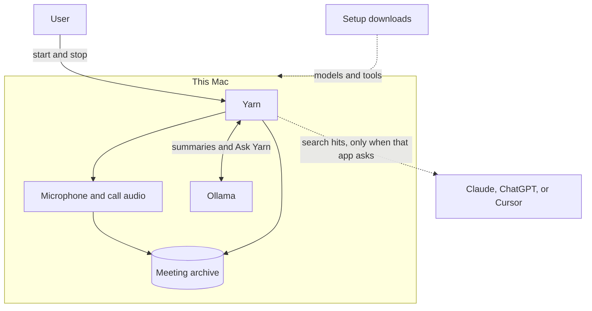
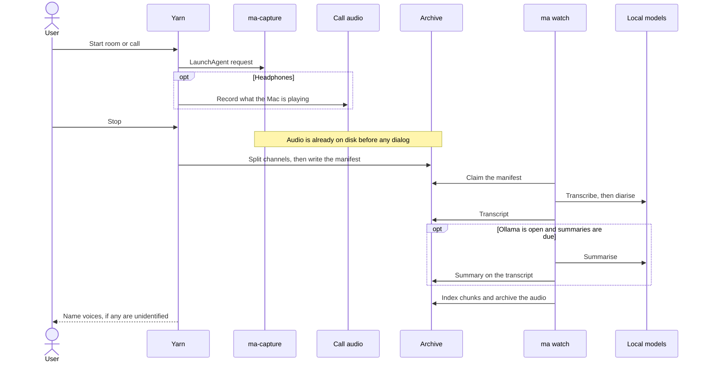
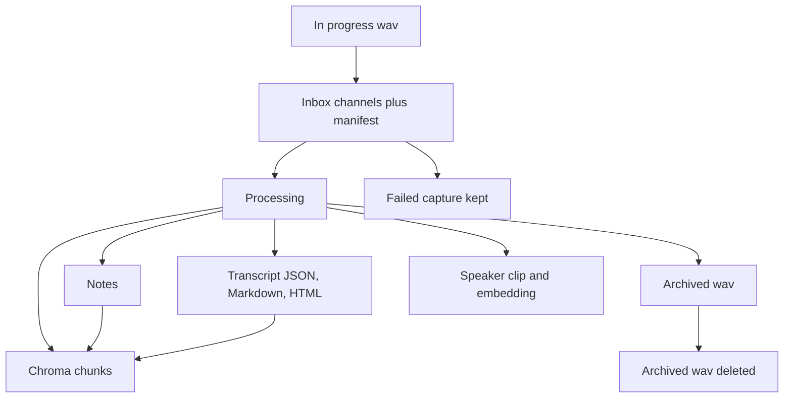
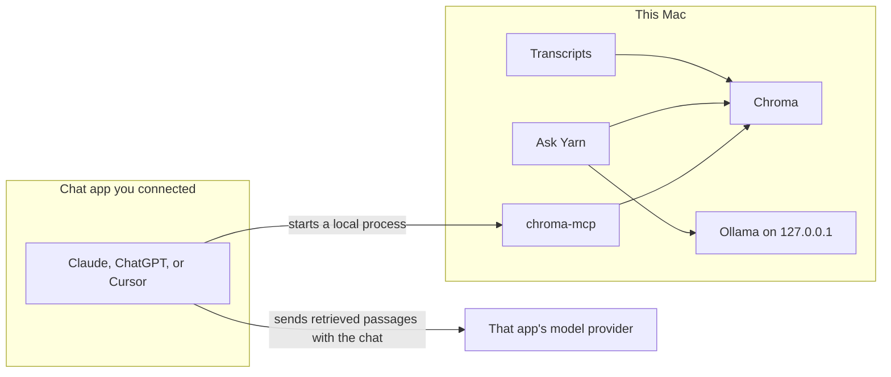
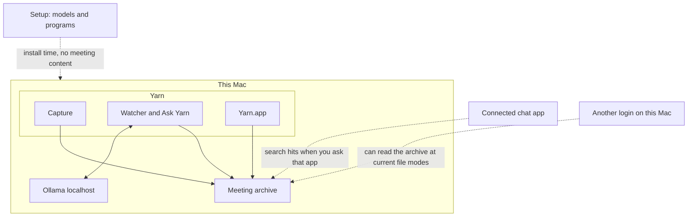

# Yarn — technical solution design

This describes Yarn as implemented in this repository. Calendar lookup is not built. Yarn has no updater of its own.

The high-level picture is in [01-high-level-architecture.md](01-high-level-architecture.md). Diagram sources are in [diagrams/](diagrams/).

## 1. System context

Yarn is a local meeting archive with a Dock app, a menu bar, and a few LaunchAgents. The person presses start. Nothing watches the calendar or listens for a wake word.



Config lives at `~/.config/meeting-archive/config.toml`, overridable with `MEETING_ARCHIVE_CONFIG`. The archive root defaults to `~/meeting-archive` and is overridden by `root` in that file. Machine toggles from the menu live in `{root}/.yarn-settings.json`.

## 2. Component architecture

```mermaid
flowchart TB
  user[User]

  subgraph ui [Controls]
    dock[Yarn.app]
    menu[Menu bar]
    popups[Notes and speaker dialogs]
  end

  subgraph capture [Capture]
    rec[bin/rec]
    mic[ma-capture]
    call[System audio in Yarn.app]
  end

  subgraph background [Background jobs]
    watcher[ma watch]
    prune[Daily audio prune]
  end

  subgraph pipeline [On stop, then in the watcher]
    finalize[ma finalize]
    whisper[whisper.cpp]
    diarize[sherpa-onnx]
    summary[Ollama summary]
    index[Chroma index]
  end

  subgraph store [Archive on disk]
    audio[Audio]
    transcripts[Transcripts and notes]
    speakers[Speaker clips]
    chroma[(Chroma)]
  end

  ask[Ask Yarn]
  mcp[chroma-mcp]
  chat[Connected chat app]

  user --> dock
  user --> menu
  dock --> rec
  menu --> rec
  rec --> mic
  rec --> call
  rec --> finalize
  finalize --> audio
  watcher --> whisper
  watcher --> diarize
  watcher --> summary
  watcher --> index
  whisper --> transcripts
  diarize --> transcripts
  summary --> transcripts
  index --> chroma
  transcripts --> chroma
  diarize --> speakers
  popups --> transcripts
  prune --> audio
  ask --> chroma
  ask --> summary
  mcp --> chroma
  chat --> mcp
```

| Component | Where it lives | Responsibility |
|---|---|---|
| `Yarn.app` | `~/Applications/Yarn.app` | Dock UI, Ask Yarn, headphone-call audio. Bundle id `com.meetingarchive.yarn`. |
| Menu bar | `~/Library/Application Support/Yarn/menu.sh` | Start, stop, and status without opening the Dock window. |
| `bin/rec` | Repo `bin/rec` | The only start/stop control. Writes the capture request. Never starts by itself. |
| `ma-capture` | LaunchAgent `com.meetingarchive.recorder` | CoreAudio recording. Idle until a request file appears. `ProcessType=Interactive` so capture is not background-throttled. |
| Call audio | Inside `Yarn.app` | ScreenCaptureKit audio stream for `rec start call`. |
| `ma finalize` | `meeting_archive/pipeline.py` | Silence and duration checks, channel split, manifest. |
| `ma watch` | LaunchAgent `com.meetingarchive.watcher` | Polls `inbox/` and runs the pipeline. Starts at login. |
| Prune | LaunchAgent `com.meetingarchive.prune` | `ma prune` daily at 09:00. |
| Dock login | LaunchAgent `com.meetingarchive.dock` | Opens Yarn at login. Does not start a recording. |
| Speaker dialogs | `Yarn Speakers.app` and `bin/speaker-popup` | Ask who an unidentified voice was, after the transcript exists. |
| Ask Yarn | `meeting_archive/ask.py`, `ui/dock/YarnChat.swift` | Local search, then a local Ollama answer. |
| `bin/chroma-mcp` | Started by a chat app via stdio | Search server over the Chroma directory. |
| Briefs | `meeting_archive/brief.py` | A local daily brief from transcripts. The login agent is optional and is not installed by the default menu installer. |

There is no mode flag threaded through the pipeline. The channel id is the fact:

| Channel | Meaning | Default label |
|---|---|---|
| `mic` | The owner’s microphone on a call | `own_label` (Jacob, unless configured) |
| `sys` | Everyone else on a call | `other_label`, then Speaker N after diarisation |
| `room` | One microphone, several people | Unknown, then Speaker N after diarisation |

`names._attribute()` depends on this. The same self-introduction on `mic` is the owner. On `room` it is someone else.

## 3. Data flows

**Recording.** `rec start room` writes a request file. The recorder LaunchAgent runs `ma-capture`, which writes a raw wav under `recordings/in-progress/` while the meeting is still going. `rec start call` also starts Yarn’s system-audio capture into `{id}__call.wav`. Samples are discarded until the microphone file has started, so the two files line up.

**Stop.** `rec stop` signals the capture. The wav header is finished. `ma finalize` then runs. A dialog after that cannot lose the file: the audio is already on disk.

**Publish.** Finalize probes duration, refuses digital silence, and refuses a file whose duration does not match wall-clock time. It extracts 16 kHz mono wavs. Room keeps `room` only. Call keeps `mic` plus `sys`. `sys` prefers the call-audio wav. An old aggregate-device tap is only a fallback, and a silent far side stays silent rather than copying the microphone onto `sys`. The raw capture is kept beside the splits. The manifest is written last. The watcher triggers on manifests only.

**Index.** `ingest()` reads the transcript and notes from disk, chunks the turns, and replaces that meeting’s Chroma rows. Notes that arrive later change the chunk count, so the write is delete-then-add, not an upsert. Metadata lists are flattened to strings because Chroma will store a list and then fail to filter on it.

**Ask.** Ask Yarn searches Chroma, or loads one meeting’s transcript when the question names it, and sends that text to local Ollama. The chat log is `{root}/asks/chat.json`.

**Connected search.** A chat app starts `bin/chroma-mcp` with `--client-type persistent` and the Chroma directory. The server reads that index over stdio. It does not open a port.

## 4. Recording-to-summary sequence



When summaries run is a setting: after the meeting, in the evening, or only when asked. If Ollama is closed, the transcript is still saved and the summary stays deferred. The watcher does not start the Ollama daemon to find out. It probes `GET /api/tags` on the configured host. `ollama list` is used only after that probe succeeds, and it checks that the configured model is already installed. A missing model is not downloaded from a summary.

While a recording is active and memory pressure is warn or critical, the watcher will not start a new Whisper or summary stage. A stage already running is left to finish. Capture stays in its own process.

## 5. AI processing pipeline

Stages, in order, from `meeting_archive/jobs.py`:

| Stage | Required | On failure |
|---|---|---|
| transcribe | yes | Audio kept, job failed |
| diarize | no | Transcript kept, channel label left as-is |
| recognise | no, toggle | Speaker N kept |
| cleanup | no, off unless enabled | Raw turns kept |
| summarize | no | Transcript kept, summary deferred |
| index | needed for search | Files kept. `ma rebuild` reconstructs Chroma |

**Transcription.** The configured engine is `whisper_cpp`, model `large-v3-turbo`, file on disk. `local_files_only` defaults to true, and the config written by Setup sets it. whisper.cpp is a subprocess. Silence is stripped first with a 700 ms VAD so the far-side channel does not give Whisper a place to invent text. `faster-whisper` remains a fallback engine. It is in-process and is told not to download when `local_files_only` is set. Long files are sliced. A checkpoint under `jobs/{id}__segments.json` lets a closed lid resume. The checkpoint is removed once the transcript is written.

**Diarisation.** sherpa-onnx, local ONNX files under `{root}/models/diarization/`. Channels `sys` and `room` are diarised. `mic` is not: splitting it would invent a second owner. The first pass uses the cautious distance. A listed count is not forced on top of that pass. When the first pass found fewer substantive voices than the meeting list, Yarn clusters once more with one spare slot and drops a single sub-2s outlier. When there is no list and the first pass returned one voice of at least eight seconds, a tighter cut is tried so two people on a headphone call are not left as one. Voices under ten seconds are folded into a longer voice they sound like, or into the neighbouring voice. Voices under one second are not listed. Fragments of one person that each clear a cosine of 0.58 are joined, including a chain of those matches. A weaker resemblance is left as its own voice. The count is never used as a name.

**Names.** Pattern matching suggests attendees. A suggestion on `mic` and the same words on `room` are attributed differently. The identify box recommends a name. With an attendee list, `dialog_prediction` fills it only for an overwhelming saved-voice match (cosine at least 0.58) to someone on that list, ahead of the next listed person by 0.08 and ahead of anyone who was not there. A match to a saved voice who was not in the meeting stays blank, including when that outsider scores higher. A near tie stays blank. Without a list, a strong match (0.50, or 0.38 when nothing stronger exists) can still be offered. A name spoken in the conversation fills the box when it is already on the list or in the known-speaker library. Confirmation writes the name. The one automatic write is `leftover_assignment`: one unnamed diarised voice and exactly one unused listed name. Yarn records that pair as assumed. A confirmed voice keeps a short wav in `speakers/clips/` and the embedding in `speakers/library.json`. Those files are not part of audio retention. Playback of a clip fills digital holes shorter than 40 ms so naming a voice does not cut in and out. A real pause is left silent.

**Cleanup.** Optional proofreading pass through the local summary model. It does not replace the raw turns when it fails.

**Summary and brief.** The transcript text is POSTed to `{summary.host}/api/generate`. The default host is `http://127.0.0.1:11434`. The running Ollama on a normal install listens on that address. A daily brief is the same local model over recent transcripts.

**Embeddings.** Chroma’s default ONNX embedder (`all-MiniLM-L6-v2`) runs locally. Setup caches it on first install from Chroma’s model archive. The watcher and the MCP server both use that default on purpose. A different embedder would make search look successful and return nonsense.

## 6. Storage architecture

```
~/meeting-archive/
  recordings/in-progress/   live wav
  recordings/inbox/         split wavs plus manifest
  recordings/processing/    claimed by the watcher
  recordings/archive/       kept until the retention window
  recordings/failed/        refused or failed captures, kept
  transcripts/YYYY/MM/      {id}.json plus Markdown and HTML
  notes/                    attendees, title, keep_audio
  jobs/                     queue state and titles
  chroma/                   derived index
  speakers/clips/           confirmed voice snippets
  speakers/library.json     names and embeddings
  briefs/                   daily briefs
  asks/chat.json            Ask Yarn history
  logs/                     watcher, recorder, prune, performance
  mcp/yarn.json             local MCP spec
  models/                   whisper.cpp and diarisation weights
  .yarn-settings.json       menu toggles
```

Transcript JSON is the source of truth. Markdown and HTML are rendered views. Chroma is derived. `ma rebuild` drops and recreates the collection from the files. The watcher reopens its collection handle when a rebuild invalidates it.

Chroma is opened with `anonymized_telemetry=False`. In the pinned chromadb 1.5.9 the product-telemetry capture function is empty. The watcher LaunchAgent also sets `ANONYMIZED_TELEMETRY=false`.

## 7. Data lifecycle



Audio retention is `1_week` (7 days), `1_month`, or `never`. Prune deletes a file in `recordings/archive/` only when a transcript exists, the meeting is not marked `keep_audio`, and the file is older than the window. A meeting that never transcribed keeps its audio. Speaker clips, transcripts, notes, the index, job files, logs, and Ask history are not pruned with the wav.

`ma delete-audio` removes archived wavs for one meeting and refuses when no transcript exists. There is no single command that deletes the transcript, index, notes, and voice clip together.

Whisper’s working files under a `yarn-whisper-*` temporary directory are removed with that directory. Channel slices in `yarn-whisper-slice-*` are not. They are leftover copies of audio already stored in the archive.

## 8. MCP architecture



`bin/chroma-mcp` is a `uvx` launcher. It runs `chroma-mcp` with the persistent client and the local data directory, and sets `ANONYMIZED_TELEMETRY=false`. The server speaks stdio. It does not listen on a port.

Setup’s Ollama step writes that spec into both Claude Desktop profiles and `{root}/mcp/yarn.json`, so Claude can search without a second install step. Cursor is written only from an explicit connect. ChatGPT cannot be given a config file. Yarn prints the command to add as a local connector.

The server exposes Chroma’s collection tools: list, peek, get, query, add, update, and delete. Yarn’s arguments select the local database, not Chroma Cloud. A cloud client exists in that package and is used only if the process is started with different arguments.

Ask Yarn does not go through this server. Connecting Claude means a later search in Claude can send the retrieved text to Anthropic. That is the intended exception for a chat app, not a second copy of the recording pipeline.

## 9. Security and trust boundaries



| Boundary | What crosses it |
|---|---|
| Yarn to disk | Audio, transcripts, summaries, embeddings. This is the normal path. |
| Yarn to Ollama | Transcript text and Ask prompts, to the configured host. Default and the usual install are `127.0.0.1`. |
| Setup to the internet | Model and tool downloads. Not the contents of a meeting. |
| Chat app to its provider | Passages that app retrieved after it was connected. |
| Other macOS login | The archive is mode `755` and files are mode `644`. A home directory that is group-readable lets another `staff` account read it. |
| Ollama.app | Yarn talks to localhost. The Ollama application has its own update check. That check is not a Yarn request and does not include the transcript. |

Yarn does not ship an analytics SDK, a crash reporter, or its own update check. The app is not sandboxed. Until a Developer ID certificate is present, release builds are ad-hoc signed, which matters for Gatekeeper on a public download. That signature is not a second network path for meetings.

## 10. macOS permissions

| Permission | Who asks | Why |
|---|---|---|
| Microphone | `ma-capture` under launchd | Room recordings and the owner’s side of a call. The Dock app does not hold this. A menu-bar child would be granted silence instead of a prompt. |
| Screen and System Audio Recording | `Yarn.app` | Headphone calls. The stream is registered as audio, at a 2×2 frame size, and Yarn writes a wav of what the Mac is playing. Room recordings do not ask. |
| Files | The user account | The archive, `~/Library/Application Support/Yarn`, and LaunchAgents in `~/Library/LaunchAgents`. |
| Automation | `osascript`, only when connecting Claude | Quit and reopen Claude so the config write is not overwritten on quit. |

Microphone and call-audio permission are different grants. A room recording needs the first. A headphone call needs both. The first Allow on a Mac is still a click. An Apple Developer ID keeps the call-audio grant across later installs. An ad-hoc rebuild does not, so Setup clears ScreenCapture and AudioCapture only when `Yarn.app` is not Developer ID signed. The enrolment and release steps are in [docs/signing.md](../signing.md).

The recorder must not be installed under Downloads, Desktop, Documents, or iCloud Drive. launchd is refused there, and the symptom is an empty recording. Setup copies a checkout out of those folders into `~/Library/Application Support/Yarn/app` before it writes LaunchAgents.

## 11. Background processing

| Agent | Run | Process type |
|---|---|---|
| `com.meetingarchive.recorder` | On demand | Interactive |
| `com.meetingarchive.watcher` | Login, kept alive | Background |
| `com.meetingarchive.prune` | 09:00 | Default |
| `com.meetingarchive.dock` | Login | Opens the app in the background |
| `com.meetingarchive.brief` | Login, if installed | Background |

The watcher polls every few seconds. It claims an inbox manifest by moving it, so two watchers cannot process the same meeting. Jobs in `jobs/{id}.json` record stage status and survive a reboot. A finished stage is not repeated. Transcription is repeated only when no complete checkpoint and no transcript exist.

`ma recover` publishes or discards captures left in `in-progress/` when finalize rejected them and the menu had nowhere to show the error. `rec` also appends to `logs/rec.log`.

Imports (`ma import-audio`, `ma import-transcript`) enter the same queue. ffmpeg is used for offline conversion and probing, not for live capture. Live `ffmpeg -f avfoundation` drops samples. That path is intentionally absent.

## 12. Error handling and recovery

Failures prefer a kept file over a guessed result.

| Fault | Result |
|---|---|
| Digital silence | Not published. The usual cause is a missing microphone grant. |
| Duration far from wall clock | Not published. The raw file stays for `ma recover`. |
| Transcription failure | Audio kept at any age. No empty transcript is indexed. |
| Diarisation failure | Transcript kept. Speakers stay on the channel label. |
| Ollama down or model missing | Transcript and index kept. Summary deferred. No model pull. |
| Summary crash after the transcript exists | Watcher retries later. |
| Chroma collection replaced by `ma rebuild` | Watcher reopens the collection and continues. |
| Closed lid mid-transcription | Checkpoint resumes. The meeting is not quarantined just because the process stopped. |

Popup dismissal, or never seeing the popup, changes nothing about the recording, the transcript, or the index.

## 13. Dependencies

Runtime Python packages are pinned in `uv.lock` and installed with `uv sync --frozen` when Setup finds both `uv` and the lock. Direct packages: `faster-whisper`, `av` below 19, `chromadb`, `sherpa-onnx`, `sounddevice`. PyAV 19 breaks faster-whisper’s VAD. The capture wheel carries its own PortAudio.

Local tools, downloaded by Setup when missing:

| Tool | Role |
|---|---|
| whisper.cpp `whisper-cli` | Transcription. Prefer Homebrew. |
| ggml `large-v3-turbo` | The speech model. Hugging Face file, stored under `models/`. |
| sherpa-onnx segmentation and embedding ONNX | Diarisation and voice memory. GitHub release assets. |
| Ollama.app and `qwen3.5:4b` or `qwen3.5:9b` | Summaries and Ask Yarn. Fast (4b) is the one an 8 GB Mac can run. Accurate (9b) is disabled there. |
| ffmpeg | Offline probe and channel split. Homebrew first. A pinned static build is the fallback. |
| Chroma ONNX embedder | Cached under `~/.cache/chroma` on first search setup. |

The watcher unloads Whisper before a 9B summary. Leaving it resident is what exhausted an 8 GB machine and made every summary fail.

## 14. Installation and updates

`bin/yarn-release` builds `dist/Yarn.Setup.Apple.Silicon.zip`. Models are not in the zip. Setup downloads them after the zip is opened.

Setup (`meeting_archive/setup.py`, driven by `Yarn Setup.app`) creates the virtualenv, syncs the lockfile, downloads models, installs Ollama if needed, pulls the selected summary model, writes the Claude search config, builds or copies `Yarn.app`, and loads the LaunchAgents.

Yarn does not check for a newer Yarn. Re-running Setup repeats finished steps and skips work already present. `bin/yarn-release` signs both apps through `bin/yarn-sign`. With no Developer ID Application certificate the signature stays ad-hoc, and Setup clears the call-audio grant because that signature changes every compile. With one certificate, the same release signs with the hardened runtime and a timestamp, then notarizes the zip when the `yarn-notary` keychain profile exists. Setup then leaves the grant in place. The first Allow on a new Mac remains.

Ollama’s desktop app checks for Ollama updates on its own. That is outside Yarn’s pipeline.
